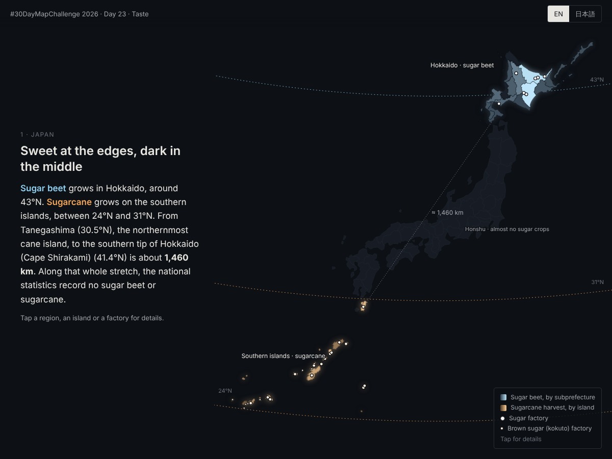

# Sugar from snow and sun / 雪と太陽の砂糖

#30DayMapChallenge 2026 · Day 23 “Senses: Taste” (posted 23 November 2026)

**https://shinyanakashima.github.io/30daymapchallenge-2026day23-snow-and-sun/**



The world makes almost all of its sugar from two plants, sugar beet and sugarcane. Japan grows both, but only at its two ends: sugar beet in Hokkaido (around 43°N) and sugarcane on the islands of Kagoshima and Okinawa (24–31°N). Once refined, both are the same substance, sucrose. The page starts with the two growing areas in Japan, moves to a spoonful of sugar on the table, and ends with the world.

The page is a scrolling story in five parts:

1. **Japan**: only the sugar regions are lit. Hokkaido subprefectures are shaded by sugar beet area, and the southern islands by cane harvest. All operating sugar factories are marked. Includes the latitudes and the distance across the gap between the two areas (about 1,460 km from Tanegashima to the southern tip of Hokkaido).
2. **Seasons**: beet harvest (October–November) and cane harvest (from December) on a month strip.
3. **Spoon**: the sugar Japan uses in a year as 100 grains: home-grown beet sugar, home-grown cane sugar, and imports.
4. **On the table**: the 27 beet grains and 8 cane grains. Beet sugar is mostly refined in Hokkaido; island raw cane sugar is refined on the main islands together with imported raw sugar.
5. **The world**: sugar beet and sugarcane make up over 99.9% of the world's sugar crop harvest by weight. The map shows countries that grow beet, cane or both (FAOSTAT 2024). All countries that grow only beet lie at 33° latitude or higher, and all that grow only cane lie below 34°. Only 14 of 137 producing countries grow both, and only 5 grow more than a million tonnes of each. Japan is one of the five.

Tap a country, subprefecture, island or factory to see its figures. English is the default; use the 日本語 button or `?lang=ja` to switch to Japanese. On devices set to reduce motion, the scroll animations are turned off.

スプーン1杯の白い砂糖は、植物から取り出したショ糖です。日本で使う砂糖のおよそ3分の1は国内で作られ、その原料は北の北海道（北緯43度前後）のてん菜と、南の鹿児島県・沖縄県の島々（北緯24〜31度）のさとうきびです。精製すればどちらも同じショ糖になります。この作品は、日本の2つの産地から食卓のスプーン1杯の砂糖へ、最後に世界へと、日本・季節・スプーン・食卓・世界の5つの場面でたどります。英語表記が基本で、「日本語」ボタン（または `?lang=ja`）で切り替えられます。

## Key figures

| | Value | Year |
|---|---|---|
| Hokkaido sugar beet, planted area | 47,965 ha | 2025 crop (令和7年産) |
| Hokkaido sugar beet, harvest | 3,194,633 t | 2025 crop |
| Hokkaido beet sugar output | 490,907 t (white and raw sugar) | 2025 crop |
| Beet sugar factories | 7 factories, 3 companies | November 2026 |
| Okinawa sugarcane harvest / sugar | 765,771 t / 91,713 t | 2025/26 season (令和7/8年期) |
| Kagoshima southern islands cane / sugar | 611,387 t / 72,705 t | 2025 crop (令和7年産) |
| Japan total sugar demand | 1,797 thousand t | Sugar year 2025/26, estimate (令和7砂糖年度 見込み) |
| Domestic sugar: beet / cane | 490 / 148 thousand t (648 total, incl. brown sugar) | Sugar year 2025/26, estimate |
| Imports | 1,144 thousand t | Sugar year 2025/26, estimate |
| Self-sufficiency | 36% (latest actual: 38%, sugar year 2024/25) | Sugar year 2025/26, estimate |
| Raw sugar imports by origin | Australia 92.4%, Thailand 7.6% | Sugar year 2024/25 |

## Data sources

All files were retrieved on 8 November 2026.

| Data | Source | Year | Notes |
|---|---|---|---|
| Sugar beet and sugarcane production by country | FAO. FAOSTAT, *Crops and livestock products* (QCL), items 0157 Sugar beet, 0156 Sugar cane and 0161 Other sugar crops n.e.c., Production. Dataset last updated 31 December 2025. https://www.fao.org/faostat/en/#data/QCL | 2024 | CC BY 4.0. Bulk file `Production_Crops_Livestock_E_All_Data_(Normalized).zip`. The "China" aggregate is dropped; mainland China and Taiwan are kept separately. |
| Sugar supply and demand, self-sufficiency, raw sugar imports | MAFF (農林水産省), 「令和8砂糖年度における砂糖及び異性化糖の需給見通し（第1回）」(September 2026). https://www.maff.go.jp/j/seisan/tokusan/kansho/attach/pdf/satou-42.pdf | Sugar years 2024/25 (actual), 2025/26 (estimate), 2026/27 (outlook) | Transcribed from the PDF: 参考資料1「砂糖及び異性化糖の需給総括表」(PDF p.6) and 7「粗糖の輸入実績」(PDF p.12). |
| Hokkaido sugar beet by subprefecture | Hokkaido Government (北海道農政部), 「令和7年産 てん菜生産実績」, table 1（総合）振興局別, p.1 | 2025 crop | Transcribed from PDF. The 14 subprefecture rows add up to the Hokkaido total. |
| Hokkaido beet sugar output, factory operating dates | Hokkaido Government, 「令和7年（2025年）産てん菜糖の生産実績」, p.1 | 2025 crop | Transcribed from PDF. |
| Hokkaido beet totals (cross-check) | ALIC (農畜産業振興機構), 統計資料 1-(2)「北海道のてん菜等の生産実績」, p.1. https://sugar.alic.go.jp/japan/data/jd1-2.pdf ; MAFF crop statistics 「令和7年産 工芸農作物の収穫量」てんさい (e-Stat) | 2025 crop | MAFF's rounded figures: 48,000 ha and 3,195,000 t. |
| Number and location of beet sugar factories | Hokkaido Government, 「北海道の畑作をめぐる情勢」(November 2026), map 「てん菜糖工場分布図（3社7工場）」, part 2, PDF p.6; Nitten Co., Ltd. office list https://www.nitten.co.jp/company/office/ | 2026 | Hokkaido Sugar's Hombetsu plant has not made sugar since sugar year 2023 and is not shown. |
| Okinawa sugarcane by island, factories, season | Okinawa Prefecture (沖縄県農林水産部), 「令和7/8年期 さとうきび及び甘しゃ糖生産実績」(August 2026), tables Ⅰ-1, 4, 5 and 7 (printed pp.1–2, 9–10, 12–17, 21–23). https://www.pref.okinawa.jp/_res/projects/default_project/_page_/001/041/379/01_seisanjisseki.pdf ; prefectural lists of centrifugal and non-centrifugal sugar factories | 2025/26 season | Transcribed from PDF. |
| Kagoshima sugarcane by island, factories, season | Kagoshima Prefecture (鹿児島県農政部), 「令和7年産 さとうきび及び甘しゃ糖生産実績（令和7/8年期）」(September 2026), table Ⅱ-1 島別生産実績 (printed p.11) and Ⅱ-9 分みつ糖工場操業実績 (printed p.19). https://www.pref.kagoshima.jp/ag06/sangyo-rodo/nogyo/nosanbutu/satokibi/documents/41531_20261007151914-1.pdf | 2025 crop | Transcribed from PDF. The ALIC article by the Kagoshima Sugar Industry Promotion Association covers the same season; the prefecture's own report was used. |
| Sugar is sucrose; refining of beet and cane sugar | ALIC, 「砂糖はなにからできているの？」 https://alic.go.jp/koho/mng01_000024.html and 「砂糖の原料について～てん菜～」 https://alic.go.jp/koho/kikaku03_000770.html | – | Beet sugar is mostly refined in Hokkaido; island raw cane sugar is refined in mainland refineries with imported raw sugar. |
| World map | Natural Earth 1:50m Admin 0 Countries, v5.1.1 | – | Public domain. |
| Japan base map | Natural Earth 1:10m Admin 1 States and Provinces, v5.1.1 | – | Public domain. |
| Hokkaido subprefectures, southern island outlines | 国土数値情報 行政区域データ (N03), 1 January 2025, MLIT: Hokkaido (01), Kagoshima (46), Okinawa (47). https://nlftp.mlit.go.jp/ksj/gml/datalist/KsjTmplt-N03-2025.html | 2025 | Hokkaido dissolved by subprefecture. Southern municipalities are split into separate islands and matched to the islands in the cane tables. |
| Some factory and island positions | GSI (国土地理院) address search API | – | See the precision notes below. |

### How values were transcribed

- National and prefectural figures come from PDF reports. The text in the MAFF PDF has no Unicode mapping, so its pages were rendered as images and read from the tables. The other PDFs were read from their text layer.
- Each transcribed value is recorded with the report, table name and page:
  - `data/supply.json`: MAFF supply and demand, imports
  - `data/transcribed/hokkaido.json`: Hokkaido sugar beet, beet sugar factories
  - `data/transcribed/south.json`: Okinawa and Kagoshima cane, cane sugar factories
  - `data/transcribed/japan_extra.json`: source list, notes, season months
- Totals were checked against the sum of their rows:
  - Hokkaido subprefectures and beet sugar factories match the Hokkaido totals exactly.
  - Okinawa islands differ from the total by 1 ha (rounding).
  - Kagoshima islands differ from the total by 1 t of sugar (rounding).
- `data/japan_sugar.json` (the file the page reads) is generated from the transcription records by `scripts/build_japan_sugar.py`.

## Notes

- **Scope.** The piece covers sugar (sucrose) and the crops it is made from. Isomerized sugar (syrup made from starch) is not included, nor is small-scale growing outside the national statistics, such as sugarcane for wasanbon sugar in Shikoku.
- **World latitudes.** Country latitudes in the world scene are Natural Earth label points (`LABEL_Y`), not where the crops grow inside each country.
- **Different year types.** World figures are calendar year 2024. Hokkaido beet is the 2025 crop (年産: harvested autumn 2025, processed October 2025 – May 2026). Okinawa cane is the 2025/26 season (年期), and Kagoshima cane the 2025 crop. Both were grown in 2025 and harvested and crushed December 2025 – May 2026. Supply, demand and self-sufficiency use the sugar year (砂糖年度, October–September).
- **Estimate vs actual.** The spoon uses sugar year 2025/26, which MAFF lists as an estimate (見込み). The latest actual year is 2024/25 (self-sufficiency 38%).
- **Sugar basis.** In the supply table, centrifugal sugar is on a refined-sugar basis and non-centrifugal (brown) sugar on a product basis. Hokkaido's 490,907 t is the actual output of the 2025 crop, white sugar plus raw sugar; it is not a white-sugar equivalent. Domestic production includes non-centrifugal sugar. Self-sufficiency is the table's "②／①": domestic production divided by total demand.
- **Spoon grains** are percentages of total demand rounded to whole grains: beet 27, cane 8, other domestic 1, imports 64.
- **Imports.** Raw sugar import origins are customs data for raw sugar, cane raw sugar and high-pol raw sugar, from the Ministry of Finance trade statistics as tabulated by MAFF.
- **Miyako-jima and Irabu-jima sugar** is counted by factory. The Gusukube factory on Miyako also crushed some cane from Irabu.
- **Season months.** Cane harvest months are inferred from factory operating dates: harvest runs in step with crushing. Beet harvest months come from ALIC and MAFF; beet processing months are the 2025-crop slicing dates.
- **Factory positions.** The Nitten factories and four Okinawa factories (Yugafu, Okinawa Seito, Miyako Seito Gusukube, Ishigakijima Seito) are at address level. The other Okinawa factories are at district (字) level. The Hokuren and Hokkaido Sugar factories, and the Kagoshima factories, are town or district points, not exact sites. This is shown in each factory's details. Kagoshima's 43 small non-centrifugal (kokuto) makers are counted in the island figures but not mapped individually.
- **Island points.** Island points used for tap targets are GSI place-name or town-office points, not computed centroids.

## Build

```sh
# geometry (needs mapshaper and the downloaded Natural Earth / N03 files)
sh scripts/build_geo.sh <download-folder>
# FAOSTAT extract
python3 scripts/build_fao.py "Production_Crops_Livestock_E_All_Data_(Normalized).csv" 2024 > data/fao_sugar.json
# page data from the transcription records
python3 scripts/build_japan_sugar.py
# check: no console errors, no 404s, screenshot of the Japan scene at 1200×900
python3 -m http.server 8000 &
node scripts/check.js http://localhost:8000/ docs/screenshot.png
```

The page is static: `index.html`, `css/`, `js/` (with d3 v7.9.0 and topojson-client v3.1.0 in `js/vendor/`) and `data/`. It is deployed to GitHub Pages by `.github/workflows/pages.yml`.

## Licence

Code: MIT (see `LICENSE`). FAOSTAT data: CC BY 4.0, © FAO. Natural Earth: public domain. 国土数値情報: MLIT (出典：国土交通省 国土数値情報). Figures from Japanese government reports are cited above.
